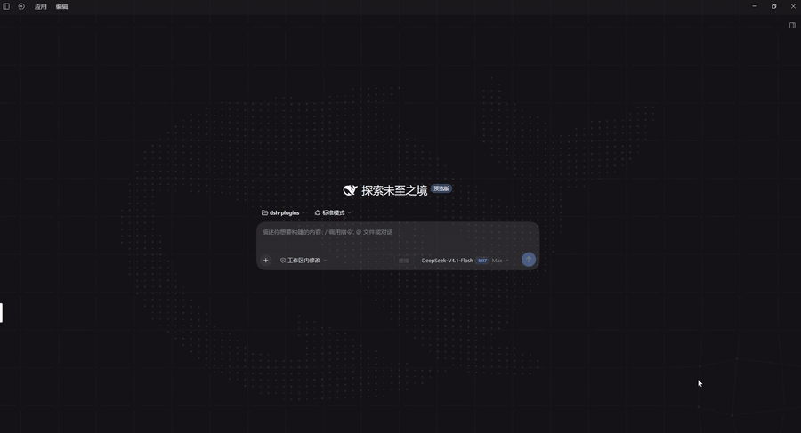

# dsh-whale-particles-bg

[English](#english) | [中文](#中文)

Animated whale particle background for the [DeepSeek Harness](https://www.deepseek.com/harness/) (`dsh`) Web UI — the WHALE-silhouette particle field plus the official dot-grid layer, registered into the frame-wide `shell.overlay` seat.

Topics: `dsh-plugin` · `deepseek-harness` · `cordis-plugin`

---

## English

### Preview

7.5-second capture of the whale field assembling from its scattered shell, breathing at idle, and the pointer carving a channel that slowly closes again (`src/preview.gif`, animated GIF, 900×487, 12fps, 7.5s, 3.2 MB):



### What it is

| Layer | Content |
| --- | --- |
| Whale (z-index 1) | Particle field sampled from the WHALE SVG path (24×18 viewBox, 6× offscreen rasterization, sampled every 2px). Particles assemble from a scattered shell, breathe when idle, and are pushed aside by a decaying scalar field left along the pointer's path: slow drags stay smooth, fast sweeps cut a channel that closes again in about a second (see [How the pointer wake works](#how-the-pointer-wake-works)). |
| Dot grid (z-index 0) | 90px square lattice with neighbour lines and a 140px pointer attraction that swells the dots. |

Both layers are fixed, full-viewport, click-through canvases. The theme is read from `body[data-ds-dark-theme]` on every frame (dark: `rgb(215,232,255)`, light: `rgb(50,82,135)`), so light/dark follows with no subscription. Animation runs on `requestAnimationFrame` throttled to ~30fps, which also suspends it while the tab is hidden.

### How the pointer wake works

The pointer never moves a particle directly. Three stages:

1. **Field.** A coarse scalar grid over the canvas (12 px cells) is multiplied by `0.94` every frame, and the pointer stamps a 300 px cubic kernel into it (`(1 - r/300)^3`). The field is therefore a "pheromone" map of the pointer's path over roughly the last second, not a single point.
2. **Force.** Each particle samples the field bilinearly and uses its negative gradient as the push direction and its value as the strength (`power = min(1, F * (1 - 0.94))`, with a `0.01` dead zone that drops sub-pixel pushes). Stamps are laid along the frame's movement (`ceil(delta / 40)` of them, at most 8) and scaled by a low-passed pointer speed, so a fast sweep cuts deeper than a slow drag.
3. **Motion.** The push is an acceleration, not a target position: `v += ((target - offset)*k - v*c)*dt`, `offset += v*dt`, with `k/c = 120/14` while pushed and `2.5/2.2` on release, plus a `2000 px/s` speed cap and a `150 px` offset cap so a released particle cannot coast off the whale.

A still pointer settles into a steady blob whose normalised value reproduces the original radial falloff exactly (peak `2 * unit * strength` ≈ 99 px at 1920×1080, about 12 px at half the radius, zero at the edge), so hovering feels unchanged. Measured overhead: +15 us per frame on a slow drag to +50 us on a fast sweep (0.04 %-0.15 % of a 30 fps frame at 1778 particles).

### Install

Prerequisites: a dsh deployment with the `dsh` CLI on `PATH` (or a source checkout, where `pnpm dsh …` works).

```sh
dsh plugin --profile web add git+https://github.com/kviiinh/dsh-whale-particles-bg.git

#    other sources:
#      local path : dsh plugin --profile web add /abs/path/to/this/repo
#      npm        : dsh plugin --profile web add dsh-whale-particles-bg   (if published)
```

This package is a **bundle**: it declares `dsh.bundle`, so the install appends it to the profile's `dsh.profile.bundles` and the package's own `cordis.patch.yml` inserts the plugin row (`id: whale-particles-bg`). There is nothing to hand-edit, and `dsh plugin --profile web remove dsh-whale-particles-bg` removes both the dependency and the layer.

Restart the harness (`dsh web`). **Settings → Plugins → Plugin list → Global plugins** then lists `whale-particles-bg` as running, and the whale background appears behind the UI.

> `lib/` is committed on purpose. The browser half must be a `window.__ModuleLoader__.load({ id, factory })` bundle produced by dsh's own tsdown preset (`packages/client/tsdown.client.ts`), which only exists inside a dsh checkout. Shipping the built artifact is what makes a git-installed copy loadable without a build step, and it keeps installs free of any `prepare`-script permission prompt. There is deliberately no `prepare` script.

### Rebuild after a dsh upgrade

```sh
scripts/build.sh /path/to/deepseek-harness     # or: DSH_CHECKOUT=/path/to/deepseek-harness scripts/build.sh
```

The checkout is always named explicitly — the script assumes no personal directory layout. It stages the sources into `<checkout>/packages/client/dsh-whale-particles-bg/`, runs `pnpm install` → `tsc -b` → `tsdown --env.DSH_BUILD_FACE client`, copies `lib/` back here, then removes the staged copy and restores `pnpm-lock.yaml` and `pnpm-workspace.yaml` from a snapshot taken up front — including when the build fails.

The last step is `scripts/sanitize-artifacts.mjs`, which scrubs machine-specific content out of the built artifacts and **fails the build** if any survives. It exists because the client preset writes virtual module ids containing the absolute source path (for example `\0dsh-global-css:<virtual>/global.css.mjs`) into a `//#region` comment inside `lib/client.js` — a string every browser loading the plugin downloads, which would leak the host user name, home layout and checkout location. Should a build emit a sourcemap, the scrub also rewrites its `sources` so they resolve from `lib/` into this package instead of naming the build staging path.

### Layout

| Path | Purpose |
| --- | --- |
| `src/client/index.tsx` | Browser half: the two canvas components and the `shell.overlay` registration |
| `src/client/whale-path.ts` | The WHALE path constant |
| `src/client/global.css` | Page background color/gradient (injected as a tagged `<style>` at factory execution) |
| `src/preview.gif` | Animated GIF preview (900×487, 12fps) embedded by the Preview section above |
| `src/index.ts` | Node half: an empty `apply` (a pure UI plugin only needs to exist in the Loader) |
| `cordis.patch.yml` | The bundle layer: inserts the `whale-particles-bg` row |
| `lib/` | Built artifacts: `index.js` (node half) + `client.js` (the `__ModuleLoader__` factory bundle) |
| `scripts/build.sh` | Rebuild against a checkout, copy the artifacts back, then sanitize them |
| `scripts/sanitize-artifacts.mjs` | Strip machine-specific content from `lib/` and fail the build if any survives |

### Listing in the plugin market

The community market ([dsh-market](https://github.com/dsh-market/dsh-market)) is served by the curated [awesome-dsh-plugin](https://github.com/awesome-dsh-plugin/awesome-dsh-plugin) registry, so being in that registry is what makes a plugin installable from **Settings → Plugin Market**. Three things get a plugin there:

1. the repository carries the `dsh-plugin` GitHub topic;
2. the package declares a `dsh.bundle` manifest (this one does);
3. one entry is submitted by pull request into the registry's **UI Enhancements** category.

### Notes and limits

- `global.css` overrides the `body` background with `!important`, so it affects the whole page. Making it configurable means registering a settings namespace and shipping a card in the Plugins settings tab.
- No settings namespace and no host-side behavior, so no per-package approval is required. Disable it with `dsh plugin --profile web remove dsh-whale-particles-bg`, or set `disabled: true` on the row in the profile patch.
- Out-of-tree plugins carry a `@deepseek-ai/cordis` peer dependency; after a major dsh upgrade, rebuild the package if the peer no longer matches.

---

## 中文

鲸鱼粒子背景 —— dsh web 客户端的**正式插件包**（bundle 形态，可 `dsh plugin add` 一键安装，替代只在进程内存里存活的动态 Cordis 插件）。

- **鲸鱼层**（z-index 1）：从 WHALE 路径栅格化采样的粒子场（24×18 viewBox，6 倍离屏栅格化、每 2px 采样），入场从散点聚合、空闲呼吸与尾部波浪；指针经过时沿路径留下一条会缓慢合拢的通道（见下文「指针作用算法」）
- **点线网格层**（z-index 0）：90px 点阵 + 邻居连线 + 指针 140px 吸引/放大
- **主题适配**：每帧读 `body[data-ds-dark-theme]`；深色 `rgb(215,232,255)` / 浅色 `rgb(50,82,135)`
- **挂载点**：`shell.overlay`（由 `@deepseek-ai/dsh-client-ui-layout` 声明的 root 作用域 list 槽位），两个全屏 fixed canvas、`pointer-events: none`
- **帧率**：`requestAnimationFrame` 限 30fps（`FRAME_MS = 33`）；页面隐藏时浏览器自动暂停 rAF

### 预览

7.5 秒录屏：粒子从散点聚合、空闲呼吸，以及指针划过时切开的通道缓慢合拢（动图 `src/preview.gif`，900×487，12fps，7.5s，3.2 MB）：


### 目录

| 文件 | 说明 |
| --- | --- |
| `src/client/index.tsx` | 浏览器半边：两个 canvas 组件 + `shell.overlay` 注册 |
| `src/client/whale-path.ts` | WHALE 路径常量（从原动态插件备份机械提取，md5 一致） |
| `src/client/global.css` | 页面背景色/渐变（构建时以带标记的 `<style>` 注入） |
| `src/preview.gif` | 上方「预览」内嵌的动图（900×487，12fps） |
| `src/index.ts` | Node 半边：空 `apply`（纯 UI 插件只需在 Loader 里出现） |
| `cordis.patch.yml` | bundle 层：插入 `whale-particles-bg` 这一行 |
| `lib/` | 构建产物：`index.js`（node 半）+ `client.js`（`__ModuleLoader__` 工厂 bundle） |
| `scripts/build.sh` | 在指定 checkout 中重新构建、拷回产物，并做脱敏 + 校验 |
| `scripts/sanitize-artifacts.mjs` | 清除 `lib/` 里的本机信息，若有残留则让构建失败 |

### 指针作用算法

指针从不直接改粒子位置，分三步：

1. **场**：画布上铺一张粗网格标量场（12px 一格），每帧整场乘 `0.94` 衰减，并在指针处盖一个 300px 的三次方核（`(1 - r/300)³`）。于是场是「指针过去约 1 秒走过的路径」的地图，而不是一个点。
2. **力**：每颗粒子双线性采样场，取场的**负梯度**作为推力方向、场值作为力度（`power = min(1, F × (1 - 0.94))`，低于 `0.01` 的死区直接当作无推力）。盖章点沿本帧的位移铺开（`ceil(位移 / 40)` 个，最多 8 个），并按低通后的指针速度做增益——快划比慢拖划得更深。
3. **动**：推力是加速度而不是目标位置——`v += ((目标 - 位移)·k - v·c)·dt`，`位移 += v·dt`；有推力时 `k/c = 120/14`，松手后 `2.5/2.2`，另有 `2000 px/s` 速度上限和 `150px` 位移上限，保证粒子不会被惯性甩出鲸鱼轮廓。

指针静止时场会稳定成一个小包，归一化后与原本的径向曲线完全一致（1920×1080 下峰值 `2 × unit × strength` ≈ 99px、半个半径处约 12px、边缘 0），所以悬停手感不变。实测开销：慢速拖动约 +15µs、快速掠过约 +50µs（1778 颗粒子，占 30fps 帧预算的 0.04%–0.15%）。

### 安装

```sh
dsh plugin --profile web add git+https://github.com/kviiinh/dsh-whale-particles-bg.git
# 或本地路径：dsh plugin --profile web add /绝对路径/dsh-whale-particles-bg
```

本包是 **bundle**（声明了 `dsh.bundle`）：安装时会自动把包追加进 profile 的 `dsh.profile.bundles`，并由包内自带的 `cordis.patch.yml` 插入插件行（`id: whale-particles-bg`）。**不需要手改任何补丁文件**；`dsh plugin --profile web remove dsh-whale-particles-bg` 会同时移除依赖与这一层。

重启 `dsh web` 后生效，插件会出现在 **设置 → 插件 → 插件列表** 的「全局插件」分组。

> 若 `dsh` 不在 PATH 上（源码方式运行），用 `pnpm dsh plugin --profile web add <路径>`。

### 上架插件市场

社区市场 [dsh-market](https://github.com/dsh-market/dsh-market) 的数据来自精选注册表 [awesome-dsh-plugin](https://github.com/awesome-dsh-plugin/awesome-dsh-plugin)——进了该注册表，才能在 **设置 → 插件市场** 里一键安装。三个条件：

1. 仓库带 `dsh-plugin` GitHub 话题；
2. 包声明 `dsh.bundle`（本包已满足）；
3. 向注册表的 **UI Enhancements** 分类提一个 PR 条目。

### 重新构建（DSH 升级后）

```sh
scripts/build.sh /path/to/deepseek-harness     # 或：DSH_CHECKOUT=/path/to/deepseek-harness scripts/build.sh
```

checkout 必须显式给出——脚本不假设任何个人目录布局。流程：把源码暂存到 `<checkout>/packages/client/dsh-whale-particles-bg/` → `pnpm install` → `tsc -b` → `tsdown --env.DSH_BUILD_FACE client` → 把 `lib/` 拷回本目录 → 删除暂存目录，并从**开头的快照**恢复 `pnpm-lock.yaml` 与 `pnpm-workspace.yaml`（失败时同样会还原）。

最后一步跑 `scripts/sanitize-artifacts.mjs`：把产物里的本机相关信息脱敏，**只要还有残留就让构建失败**。之所以需要它：客户端预设会把绝对源码路径写进虚拟模块 id（例如 `\0dsh-global-css:<virtual>/global.css.mjs`），出现在 `lib/client.js` 的 `//#region` 注释里——而这是每个加载插件的浏览器都会下载的字符串，会泄漏宿主用户名、家目录布局与 checkout 位置。构建如果产出了 sourcemap，脱敏同时会把它的 `sources` 改写成从 `lib/` 指向本包 `src/`，不再出现构建暂存路径。

**为什么必须暂存进 checkout**：共享 tsdown 预设 `packages/client/tsdown.client.ts` 会按名字在 `packages/*/*` 下查找包清单，工作区之外的包会直接抛错（`no packages/*/*/package.json declares the name ...`）。

### 从动态插件移植时的差异

| 项 | 动态插件（whale-bg） | 本包 |
| --- | --- | --- |
| 外形 | `cordis_define` 的 JS 函数体字符串 | npm 包（TS/TSX + 构建产物） |
| 槽位 API | `ctx.get('slots').inject/register` | `ctx.slots.inject/register`（**相同契约**） |
| 样式 | `styles.insert(...)` | `import './global.css'`（构建时注入带标记 `<style>`） |
| 定时器 | `ctx.timer.interval(draw, 33)` | `requestAnimationFrame` + 33ms 累加器 |
| 隐藏暂停 | `visibilitychange` 监听 | 不需要（rAF 自动暂停） |
| 生效范围 | 当前会话、需授权、重启即失 | 全局、随部署启动、无需授权 |

### 已知限制

- `global.css` 用 `!important` 覆盖 `body` 背景，**影响整个页面**。如需可配置，可再注册一个 settings 命名空间并在「插件配置」里出卡片。
- 未注册 settings、无 host 半逻辑，因此不需要逐次授权。停用方式：`dsh plugin --profile web remove dsh-whale-particles-bg`，或在 profile 补丁里给该行加 `disabled: true`。
- 外部插件对 `@deepseek-ai/cordis` 有 peer 依赖；DSH 大版本升级后若 peer 不匹配，需要重新构建本包。

## License

MIT — see [LICENSE](./LICENSE).
